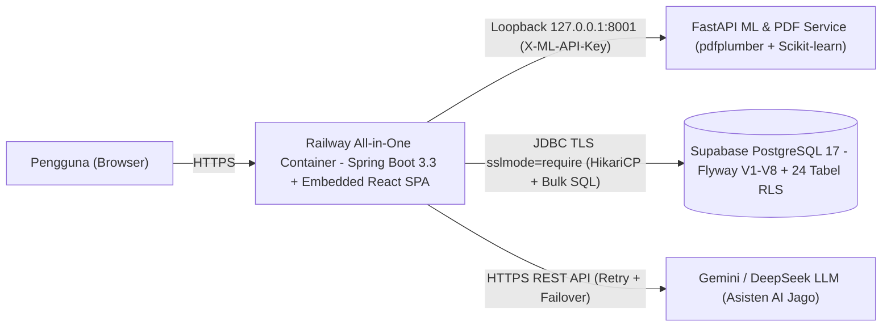
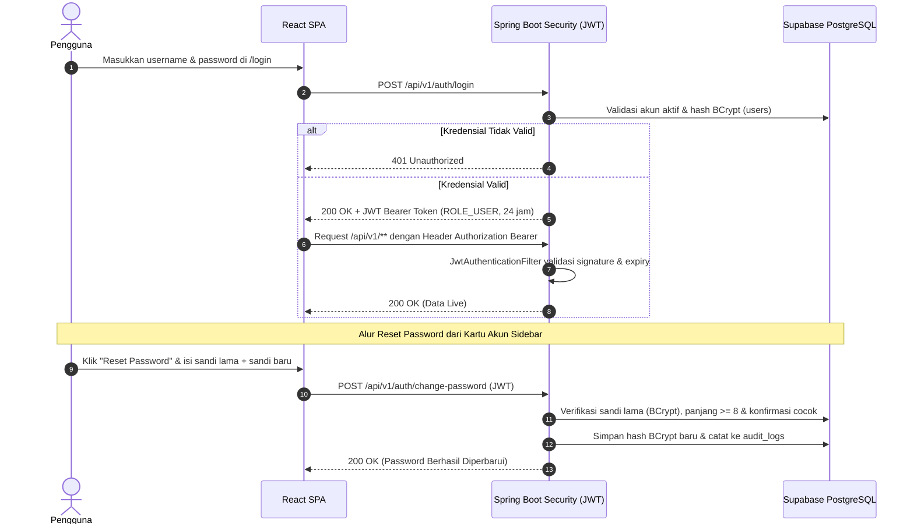
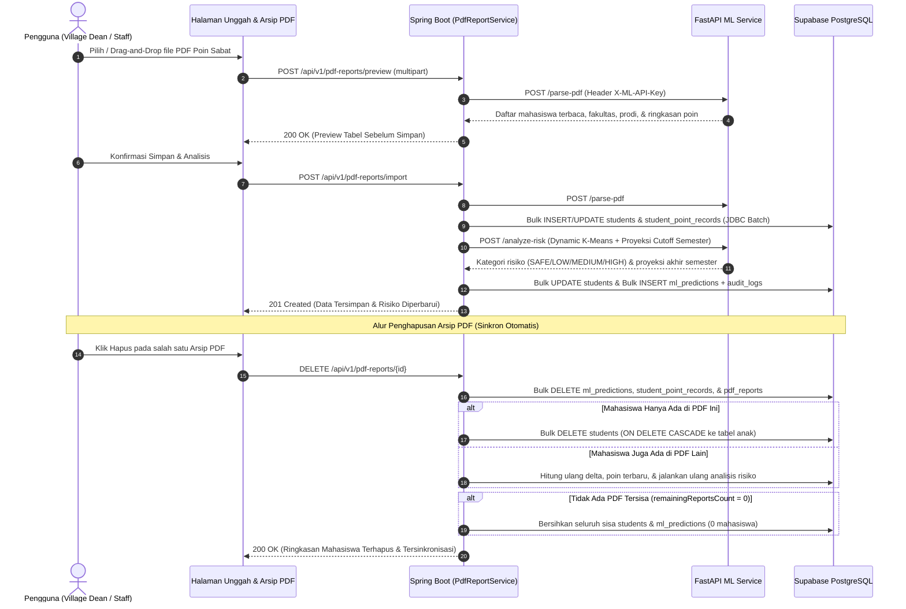
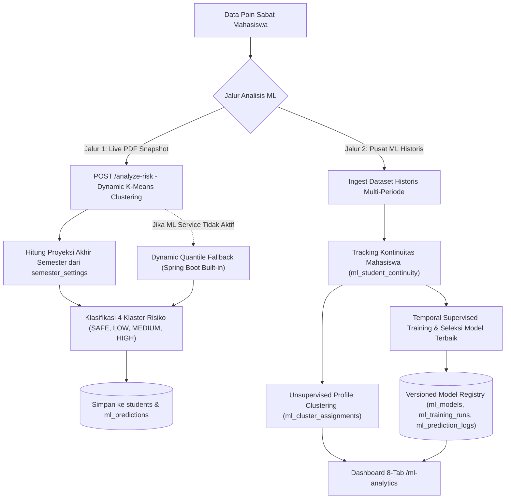
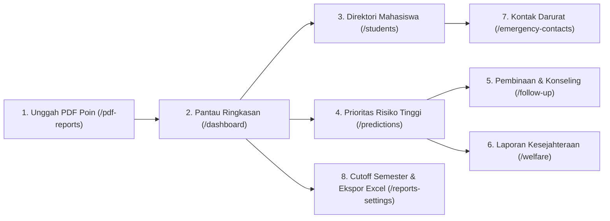
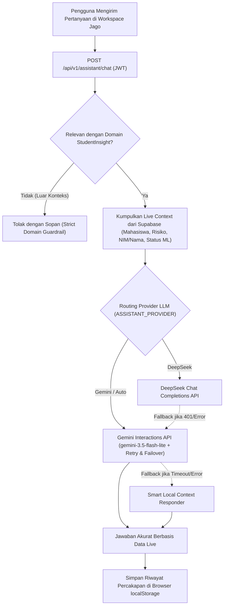
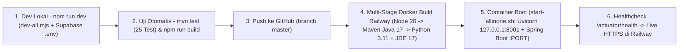

# Struktur Workflow Sistem — StudentInsight

Dokumentasi ini merangkum seluruh alur kerja (*workflow*) arsitektur, autentikasi, pemrosesan data berbasis PDF, Machine Learning, Asisten AI **Jago**, manajemen database **Supabase**, hingga pipeline deployment **Railway** pada proyek **StudentInsight** (Sistem Monitoring Poin Sabat & Deteksi Risiko Mahasiswa Universitas Klabat).

---

## 1. Arsitektur & Alur Sistem End-to-End

| Lapisan | Teknologi | Peran Utama |
|---|---|---|
| **Frontend (SPA)** | React 18, TypeScript, Vite, Tailwind CSS | Dashboard analitik, unggah/arsip PDF, direktori mahasiswa, pusat ML, Mode Panduan Interaktif, modal Reset Password, dan workspace chat Jago. |
| **Backend API** | Spring Boot 3.3 (Java 17), Spring Security JWT, Flyway | Autentikasi JWT, orkestrasi impor/hapus PDF (*bulk SQL* + *JDBC batch*), manajemen pembinaan/kesejahteraan/kontak darurat, ekspor Excel, dan orkestrasi Jago AI. |
| **ML & PDF Service** | Python 3.11, FastAPI, `pdfplumber`, Scikit-learn | Ekstraksi tabel PDF Village Dean, *Dynamic K-Means Risk Clustering*, proyeksi akhir semester, serta pipeline ML Historis (*clustering* & prediksi temporal). |
| **Cloud Database** | Supabase PostgreSQL 17 (Session Pooler) | Penyimpanan terpusat seluruh entitas dengan enkripsi TLS dan **Row Level Security (RLS)** aktif pada seluruh 24 tabel (`0` akses publik `anon`/`authenticated`). |

---

## 2. Workflow Autentikasi, Otorisasi & Reset Password

- Seluruh endpoint `/api/**` dan `/actuator/**` (kecuali `/api/v1/auth/login`, `/api/v1/auth/logout`, dan `/actuator/health`) **wajib JWT valid**.
- Akun demo warisan (`admin`, `staff`, `dean`) telah dihapus permanen melalui migrasi `V8` sehingga hanya akun resmi yang dapat mengakses sistem.

---

## 3. Workflow Utama: Siklus Hidup Data Berbasis PDF (Upload, Sync & Delete)

StudentInsight menggunakan arsitektur **100% PDF-driven** — data mahasiswa di direktori selalu sinkron dengan arsip PDF yang diunggah.

---

## 4. Workflow Machine Learning (Deteksi Risiko Dinamis & Pusat ML Historis)

---

## 5. Workflow Operasional Monitoring & Intervensi Mahasiswa

- **Mode Panduan Interaktif (*Spotlight Guide*)**: Tersedia langsung dari Sidebar (*Tur Aktif* & *Panduan*) untuk menyorot elemen layar langkah demi langkah di setiap halaman.

---

## 6. Workflow Asisten AI "Jago"

---

## 7. Workflow Evolusi Database (Flyway `V1`–`V8`) & Keamanan Supabase

Setiap kali Spring Boot dijalankan, Flyway otomatis memvalidasi dan menerapkan migrasi secara berurutan:

| Versi | File Migrasi | Ringkasan Perubahan |
|---|---|---|
| `V1` | `V1__init_schema.sql` | Inisialisasi 13 tabel inti (`users`, `students`, `residence_categories`, `attendances`, `violation_points`, `welfare_reports`, `follow_up_records`, `emergency_contacts`, `ml_predictions`, `audit_logs`, dll.) dengan relasi `ON DELETE CASCADE`. |
| `V2` | `V2__seed_initial_data.sql` | Seed data referensi awal (kategori tempat tinggal, aturan kehadiran/poin, data demo awal v1). |
| `V3` | `V3__pdf_monitoring_overhaul.sql` | Transisi ke monitoring berbasis PDF: tambah `semester_settings`, `pdf_reports`, `student_point_records`, serta kolom proyeksi/delta pada `students` dan `ml_predictions`. |
| `V4` | `V4__ml_historical_subsystem.sql` | Tambah 7 tabel subsistem ML Historis (`ml_dataset_versions`, `ml_reporting_periods`, `ml_student_continuity`, `ml_training_runs`, `ml_models`, `ml_cluster_assignments`, `ml_prediction_logs`). |
| `V5` | `V5__normalize_legacy_user_roles.sql` | Normalisasi seluruh role akun ke skema single-role `ROLE_USER`. |
| `V6` | `V6__enable_rls_security.sql` | Aktifkan **Row Level Security (RLS)** pada seluruh tabel aplikasi dan cabut hak akses `anon` & `authenticated` dari Data API publik Supabase. |
| `V7` | `V7__remove_legacy_demo_students.sql` | Hapus 6 mahasiswa dummy warisan `V2` beserta data relasinya agar database bersih (`0` mahasiswa) sampai PDF diunggah. |
| `V8` | `V8__remove_legacy_demo_users.sql` | Hapus akun demo lama (`admin`, `staff`, `dean`) dengan password bawaan lemah demi keamanan produksi. |

---

## 8. Workflow Pengembangan & Deployment (Local → GitHub → Railway + Supabase)

- **Development Lokal**: Jalankan `npm run dev` di folder `frontend/` — skrip [dev-all.mjs](frontend/scripts/dev-all.mjs) otomatis membaca `.env`, mendeteksi koneksi remote **Supabase** (melewati PostgreSQL lokal), lalu menyalakan ML Service (`:8001`), Backend (`:8080`), dan Vite (`:5173`) sekaligus.
- **Production Cloud**: Deploy berjalan dalam 1 container terpadu ([Dockerfile](Dockerfile)) di Railway dengan database cloud terpusat di Supabase (panduan lengkap tersedia di [RAILWAY_DEPLOY.md](RAILWAY_DEPLOY.md)).
