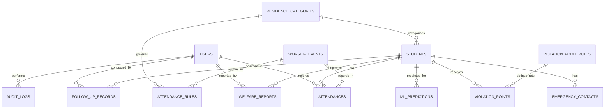

# Database Design & Entity Relationship Diagram (ERD)
## StudentInsight: Smart Student Monitoring & Prediction System

### 1. Conceptual Entity Relationship Model

---

### 2. Physical Schema Specification

#### A. `users`
- `id` (BIGSERIAL, PRIMARY KEY)
- `username` (VARCHAR(50), NOT NULL, UNIQUE)
- `email` (VARCHAR(100), NOT NULL, UNIQUE)
- `password_hash` (VARCHAR(255), NOT NULL)
- `full_name` (VARCHAR(100), NOT NULL)
- `role` (VARCHAR(30), NOT NULL) — `ROLE_ADMIN`, `ROLE_STAFF`, `ROLE_VILLAGE_DEAN`
- `is_active` (BOOLEAN, DEFAULT TRUE)
- `created_at` (TIMESTAMP WITH TIME ZONE, NOT NULL)
- `updated_at` (TIMESTAMP WITH TIME ZONE, NOT NULL)

#### B. `residence_categories`
- `id` (BIGSERIAL, PRIMARY KEY)
- `code` (VARCHAR(30), NOT NULL, UNIQUE) — `OUTSIDER_DEKAT`, `OUTSIDER_JAUH`
- `name` (VARCHAR(100), NOT NULL)
- `max_distance_meters` (INTEGER) — misal: 700 meter untuk Outsider Dekat, NULL untuk Outsider Jauh
- `description` (TEXT)
- `is_active` (BOOLEAN, DEFAULT TRUE)
- `created_at` (TIMESTAMP WITH TIME ZONE)
- `updated_at` (TIMESTAMP WITH TIME ZONE)

#### C. `students`
- `id` (BIGSERIAL, PRIMARY KEY)
- `nim` (VARCHAR(20), NOT NULL, UNIQUE)
- `full_name` (VARCHAR(150), NOT NULL)
- `study_program` (VARCHAR(100), NOT NULL)
- `faculty` (VARCHAR(100), NOT NULL)
- `phone_number` (VARCHAR(25))
- `residence_category_id` (BIGINT, NOT NULL, FK -> `residence_categories.id`)
- `current_address` (TEXT, NOT NULL)
- `status` (VARCHAR(30), NOT NULL, DEFAULT 'ACTIVE') — `ACTIVE`, `INACTIVE`, `PROBATION`, `GRADUATED`
- `qr_token` (VARCHAR(64), NOT NULL, UNIQUE) — UUID aman untuk scanning QR
- `total_violation_points` (INTEGER, NOT NULL, DEFAULT 0)
- `created_at` (TIMESTAMP WITH TIME ZONE)
- `updated_at` (TIMESTAMP WITH TIME ZONE)

#### D. `worship_events`
- `id` (BIGSERIAL, PRIMARY KEY)
- `title` (VARCHAR(150), NOT NULL)
- `event_type` (VARCHAR(50), NOT NULL) — `FRIDAY_VESPER`, `SABBATH_MORNING`, `SABBATH_AFTERNOON`, `WOP_MORNING`, `WOP_EVENING`, `WOP_CULMINATION`
- `event_date` (DATE, NOT NULL)
- `start_time` (TIME, NOT NULL)
- `end_time` (TIME, NOT NULL)
- `location` (VARCHAR(150), NOT NULL)
- `status` (VARCHAR(30), NOT NULL, DEFAULT 'SCHEDULED') — `SCHEDULED`, `ONGOING`, `COMPLETED`, `CANCELLED`
- `description` (TEXT)
- `created_at` (TIMESTAMP WITH TIME ZONE)
- `updated_at` (TIMESTAMP WITH TIME ZONE)

#### E. `attendance_rules`
- `id` (BIGSERIAL, PRIMARY KEY)
- `residence_category_id` (BIGINT, NOT NULL, FK -> `residence_categories.id`)
- `event_type` (VARCHAR(50), NOT NULL)
- `is_mandatory` (BOOLEAN, NOT NULL, DEFAULT TRUE)
- `point_penalty_weight` (INTEGER, NOT NULL, DEFAULT 5)
- `notes` (VARCHAR(255))
- `is_active` (BOOLEAN, NOT NULL, DEFAULT TRUE)
- `created_at` (TIMESTAMP WITH TIME ZONE)
- `updated_at` (TIMESTAMP WITH TIME ZONE)
- UNIQUE (`residence_category_id`, `event_type`)

#### F. `attendances`
- `id` (BIGSERIAL, PRIMARY KEY)
- `student_id` (BIGINT, NOT NULL, FK -> `students.id`)
- `worship_event_id` (BIGINT, NOT NULL, FK -> `worship_events.id`)
- `status` (VARCHAR(30), NOT NULL) — `PRESENT`, `ABSENT`, `EXCUSED`, `SICK`, `PENDING_VERIFICATION`
- `recorded_method` (VARCHAR(20), NOT NULL) — `QR_SCAN`, `MANUAL_INPUT`
- `check_in_time` (TIMESTAMP WITH TIME ZONE)
- `verified_by_user_id` (BIGINT, FK -> `users.id`)
- `notes` (TEXT)
- `created_at` (TIMESTAMP WITH TIME ZONE)
- `updated_at` (TIMESTAMP WITH TIME ZONE)
- UNIQUE (`student_id`, `worship_event_id`)

#### G. `violation_point_rules`
- `id` (BIGSERIAL, PRIMARY KEY)
- `violation_type` (VARCHAR(50), NOT NULL, UNIQUE)
- `description` (VARCHAR(255), NOT NULL)
- `default_points` (INTEGER, NOT NULL)
- `is_system_demo` (BOOLEAN, NOT NULL, DEFAULT TRUE)
- `created_at` (TIMESTAMP WITH TIME ZONE)
- `updated_at` (TIMESTAMP WITH TIME ZONE)

#### H. `violation_points`
- `id` (BIGSERIAL, PRIMARY KEY)
- `student_id` (BIGINT, NOT NULL, FK -> `students.id`)
- `worship_event_id` (BIGINT, FK -> `worship_events.id`)
- `attendance_id` (BIGINT, FK -> `attendances.id`)
- `points` (INTEGER, NOT NULL)
- `reason` (VARCHAR(255), NOT NULL)
- `status` (VARCHAR(30), NOT NULL, DEFAULT 'ACTIVE') — `ACTIVE`, `RESOLVED`, `CANCELLED`
- `adjusted_by_user_id` (BIGINT, FK -> `users.id`)
- `adjustment_notes` (TEXT)
- `created_at` (TIMESTAMP WITH TIME ZONE)
- `updated_at` (TIMESTAMP WITH TIME ZONE)

#### I. `emergency_contacts`
- `id` (BIGSERIAL, PRIMARY KEY)
- `student_id` (BIGINT, NOT NULL, FK -> `students.id`)
- `contact_name` (VARCHAR(150), NOT NULL)
- `relationship` (VARCHAR(50), NOT NULL)
- `phone_number` (VARCHAR(25), NOT NULL)
- `address` (TEXT)
- `created_at` (TIMESTAMP WITH TIME ZONE)
- `updated_at` (TIMESTAMP WITH TIME ZONE)

#### J. `welfare_reports`
- `id` (BIGSERIAL, PRIMARY KEY)
- `student_id` (BIGINT, NOT NULL, FK -> `students.id`)
- `report_type` (VARCHAR(50), NOT NULL) — `HOUSING`, `SECURITY`, `FINANCIAL`, `HEALTH`, `GENERAL_AID`
- `priority` (VARCHAR(20), NOT NULL, DEFAULT 'MEDIUM') — `LOW`, `MEDIUM`, `HIGH`, `URGENT`
- `status` (VARCHAR(30), NOT NULL, DEFAULT 'OPEN') — `OPEN`, `IN_REVIEW`, `RESOLVED`, `CLOSED`
- `description` (TEXT, NOT NULL)
- `reported_by_user_id` (BIGINT, FK -> `users.id`)
- `assigned_to_user_id` (BIGINT, FK -> `users.id`)
- `resolution_notes` (TEXT)
- `created_at` (TIMESTAMP WITH TIME ZONE)
- `updated_at` (TIMESTAMP WITH TIME ZONE)

#### K. `follow_up_records`
- `id` (BIGSERIAL, PRIMARY KEY)
- `student_id` (BIGINT, NOT NULL, FK -> `students.id`)
- `conducted_by_user_id` (BIGINT, NOT NULL, FK -> `users.id`)
- `counseling_date` (DATE, NOT NULL)
- `topics_discussed` (TEXT, NOT NULL)
- `action_plan` (TEXT, NOT NULL)
- `status` (VARCHAR(30), NOT NULL, DEFAULT 'SCHEDULED') — `SCHEDULED`, `COMPLETED`, `FOLLOW_UP_NEEDED`
- `evaluation_result` (TEXT)
- `created_at` (TIMESTAMP WITH TIME ZONE)
- `updated_at` (TIMESTAMP WITH TIME ZONE)

#### L. `ml_predictions`
- `id` (BIGSERIAL, PRIMARY KEY)
- `student_id` (BIGINT, NOT NULL, FK -> `students.id`)
- `risk_category` (VARCHAR(20), NOT NULL) — `LOW`, `MEDIUM`, `HIGH`
- `prob_low` (DOUBLE PRECISION, NOT NULL)
- `prob_medium` (DOUBLE PRECISION, NOT NULL)
- `prob_high` (DOUBLE PRECISION, NOT NULL)
- `model_name` (VARCHAR(50), NOT NULL)
- `model_version` (VARCHAR(30), NOT NULL)
- `features_snapshot` (JSONB, NOT NULL)
- `predicted_at` (TIMESTAMP WITH TIME ZONE, NOT NULL)

#### M. `audit_logs`
- `id` (BIGSERIAL, PRIMARY KEY)
- `user_id` (BIGINT, FK -> `users.id`)
- `action` (VARCHAR(50), NOT NULL)
- `entity_name` (VARCHAR(50), NOT NULL)
- `entity_id` (BIGINT)
- `old_values` (TEXT)
- `new_values` (TEXT)
- `details` (TEXT)
- `created_at` (TIMESTAMP WITH TIME ZONE, NOT NULL)
