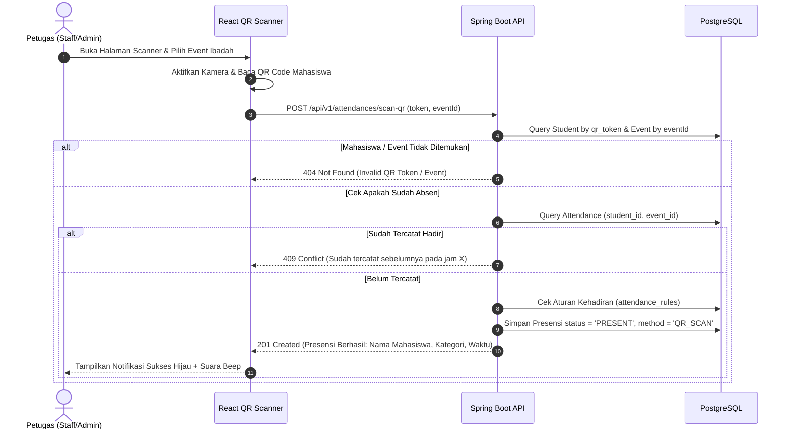
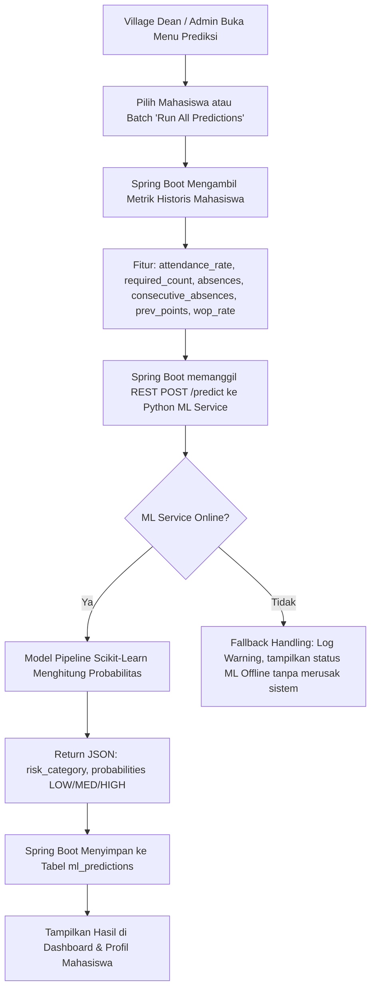

# System Workflows & Business Logic
## StudentInsight: Smart Student Monitoring & Prediction System

### 1. Workflow: Pencatatan Kehadiran QR & Validasi Kewajiban

---

### 2. Workflow: Penghitungan Poin Pelanggaran Otomatis
1. **Pemicu**: Kegiatan ibadah telah berakhir atau admin menjalankan aksi "Finalisasi Presensi Kegiatan" (`POST /api/v1/worship-events/{id}/finalize`).
2. **Identifikasi Kewajiban**:
   - Sistem mengambil daftar mahasiswa aktif.
   - Untuk setiap mahasiswa, sistem mencocokkan `residence_category` dengan `attendance_rules` untuk `event_type` terkait.
   - Jika `is_mandatory == false`, mahasiswa tidak wajib hadir dan tidak ada sanksi.
3. **Pengecekan Kehadiran**:
   - Jika mahasiswa wajib hadir dan belum memiliki catatan kehadiran, sistem membuat catatan kehadiran `ABSENT`.
   - Jika status kehadiran adalah `EXCUSED` (Izin), `SICK` (Sakit), atau `PENDING_VERIFICATION`, maka **tidak dikenakan poin**.
   - Jika status kehadiran adalah `ABSENT`:
     - Sistem mengambil bobot poin dari `attendance_rules` atau `violation_point_rules`.
     - Sistem membuat entri di tabel `violation_points`.
     - Sistem menambahkan nilai poin ke `students.total_violation_points`.
     - Sistem mencatat aktivitas di `audit_logs`.

---

### 3. Workflow: Prediksi Risiko Machine Learning

